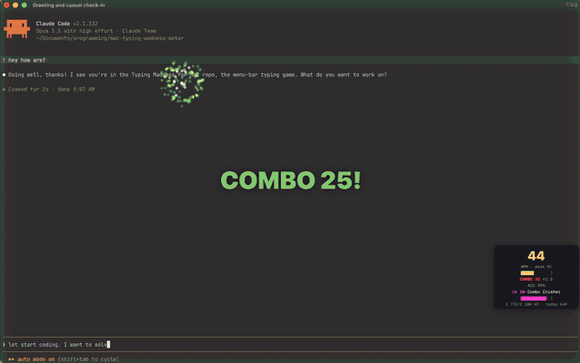

# Typing Madness for Mac

A menu-bar app that turns typing in **any** Mac app into a game. A sibling of the [herdr Typing Madness Meter](https://github.com/tomasrasymas/herdr-typing-madness-meter), using the same rules, without herdr.



[Watch the full demo in higher quality (MP4)](docs/demo.mp4)

- **Speed colors:** the window you're typing in gets a glowing border and a tint. They go green, then yellow, orange and red as your WPM climbs (25, 45, 65 and 85 WPM by default). Stop typing and they hold, then fade out after 6 seconds.
- **Insane mode:** at 110 WPM the whole screen catches fire and laser beams shoot across it. Try it with Settings › Preview: Insane.
- **Fireworks and stars:** milestones set off fireworks, and fast typing makes multicolored stars jump and small fireworks pop.
- **Window shake:** type fast and the window itself shakes, then snaps back to its exact spot.
- **Floating meter:** a small panel shows live WPM, combo, multiplier, accuracy, level and XP. Drag it anywhere, or put it in a corner of the screen or docked to the window you're typing in. Drag its edges to resize it: long and thin shows one line, wide shows two, squarish shows a stacked view with a big WPM number. Make it see-through, or hide it and keep only the effects.
- **Milestones:** every 25-key combo, level-up, new WPM record and achievement flashes the window and shows a big shaking badge (`COMBO 150!`).
- **Menu bar:** a keycap icon whose flames grow with your speed, next to your live WPM in the current speed color. The menu has your level, today's and all-time stats, on/off switches for each effect, Start at login, Pause and Reset.
- **Settings (menu-bar icon › Settings…):** every switch and number in one window, each with a `?` that explains it. Changes apply right away; Restore Defaults puts the numbers back. The Preview buttons play a celebration or Insane mode on demand.

Clicks and keys always go straight through to your apps. Nothing steals focus.

## Install

Needs macOS 13 or newer, on Apple Silicon or Intel.

### Option 1: Homebrew

```sh
brew install --cask tomasrasymas/tap/typing-madness
```

The app isn't notarized by Apple, so the first time you open it, macOS blocks it with "Apple could not verify…". Click **Done**, then go to System Settings › Privacy & Security, scroll down and click **Open Anyway**. You only need to do this once per version.

Update with `brew upgrade --cask typing-madness`. Uninstall with `brew uninstall --cask typing-madness`, or add `--zap` to also delete your stats and settings.

### Option 2: download the app

1. Download `Typing-Madness-<version>.zip` from the [latest release](https://github.com/tomasrasymas/mac-typing-madness-meter/releases/latest).
2. Unzip it and drag **Typing Madness.app** into **Applications**.
3. Open it. The app isn't notarized by Apple, so macOS blocks the first launch with "Apple could not verify…". Click **Done**, then go to System Settings › Privacy & Security, scroll down and click **Open Anyway**.

   Or, in Terminal:
   ```sh
   xattr -dr com.apple.quarantine "/Applications/Typing Madness.app"
   ```

### Option 3: build it yourself

Needs Swift 5.10 or newer. The Xcode Command Line Tools are enough.

```sh
xcode-select --install       # once, if you don't have Swift yet
git clone https://github.com/tomasrasymas/mac-typing-madness-meter.git
cd mac-typing-madness-meter
sh scripts/bundle.sh         # builds "build/Typing Madness.app"
cp -R "build/Typing Madness.app" /Applications/
open "/Applications/Typing Madness.app"
```

An app you build yourself opens without the security warning.

### Allow the permissions

Look for the flaming keycap icon in the menu bar. Then allow two things in System Settings › Privacy & Security:

- **Input Monitoring**: required. It lets the app count your keys. Until it's on, the meter shows a ⚠ line and the app keeps retrying.
- **Accessibility**: optional. It lets the app shake the window you're typing in. Without it, only the glow and effects shake. Full-screen windows never move.

If Typing Madness isn't in a list, click **+** and pick it from Applications.

After an update, macOS may ask again. The app is ad-hoc signed, so macOS treats each new build as a new app. If a switch is on but the app still asks, remove Typing Madness from the list with **−** and allow it again.

### Start at login

Turn on menu-bar icon › Start at login, or Settings › Effects › Start at login. It shows up in System Settings › General › Login Items.

### Uninstall

Quit from menu-bar icon › Quit Typing Madness and turn off Start at login. Then:

```sh
rm -rf "/Applications/Typing Madness.app" ~/Library/Application\ Support/TypingMadness
defaults delete dev.typingmadness.app
```

Remove it from Input Monitoring and Accessibility with **−**.

## How WPM is counted

- A "word" is 5 characters, the usual typing-test measure.
- Letters, digits, punctuation, space and Enter count. Backspace, arrows, held-key repeats and ⌘/⌃ shortcuts don't; Backspace lowers your accuracy instead.
- WPM looks at the last 10 seconds only: `(characters ÷ 5) × (60 s ÷ seconds since the oldest of them)`. For example, 40 characters in 8 seconds is 60 WPM.
- The time span never counts as less than 2 seconds, so a couple of quick keys can't spike it.
- Records (session peak, daily best, all-time best) need at least 25 characters in the window. A new-record celebration only fires when your best rises into the next block of 5 WPM.

## Run from a terminal

```sh
swift run TypingMadness
```

The permissions then go to your terminal app instead of Typing Madness, and Start at login doesn't work.

## How it works

| Piece | File | What it does |
|---|---|---|
| Key counter | `Sources/TypingMadness/KeyTap.swift` | A listen-only `CGEventTap` on key-down events. Each key becomes one of four kinds: character, backspace, enter or other. The text itself is never kept. Key repeats and ⌘/⌃ shortcuts don't count. |
| Active window | `Sources/TypingMadness/FrontWindow.swift` | Reads the frontmost app's top window bounds from the window server about 5 times a second. Needs no extra permission. |
| Overlay | `Sources/TypingMadness/Overlay.swift` | A transparent, click-through window kept over the active window. It draws the tint, the glowing border, flashes, badges, fireworks and stars with Core Animation. |
| Insane mode | `Sources/TypingMadness/InsaneFX.swift` | A click-through window over the whole screen: fire from the bottom and sides, and laser beams. |
| Menu-bar icon | `Sources/TypingMadness/MenuBarIcon.swift` | The keycap icon, with flames that grow with your speed tier. |
| Homebrew cask | `packaging/homebrew/typing-madness.rb` | The cask for the tap; `release.sh` keeps its version and checksum current. |
| Window shake | `Sources/TypingMadness/WindowShaker.swift` | Nudges the active window through the Accessibility API, then puts it back at its saved spot. |
| Floating meter | `Sources/TypingMadness/Meter.swift` | A click-through panel in a corner or edge of the active screen, or docked to the active window. |
| Settings | `Sources/TypingMadness/Tuning.swift`, `SettingsWindow.swift` | Every tunable number with its default, kept in UserDefaults, and the SwiftUI window that edits them. |
| Start at login | `Sources/TypingMadness/LoginItem.swift` | Registers the app as a login item with `SMAppService`. |
| App | `Sources/TypingMadness/AppDelegate.swift` | A 30 fps loop, the menu-bar item and menu, and saving stats. |
| Game rules | `Sources/MadnessCore/Game.swift` | WPM over a 10s window, combos, XP multiplier, levels, ranks and achievements. Pure, with no AppKit. |
| Speed colors | `Sources/MadnessCore/Speed.swift` | One speed tier drives every color, with hysteresis. Also the idle hold and fade. |

Stats live in `~/Library/Application Support/TypingMadness/stats.json`. Settings live in the app's UserDefaults (`dev.typingmadness.app`).

## Privacy

- Only the kind of each key is used, never which key or what you typed.
- Nothing leaves your Mac.
- Password fields turn on macOS "secure input", which hides keys from every app, including this one. The meter shows 🔒 while that's on.

## Development

```sh
swift build
swift run selftest     # checks for the game rules and speed colors
```

`selftest` is a plain executable, not `swift test`. XCTest and the Swift Testing macros need full Xcode, and this project only needs the Command Line Tools. For the same reason, the SwiftUI settings avoid `@State`, which is a macro.

### App icon

The icon is drawn in code, in `scripts/make-icon.swift`. After changing it, run `sh scripts/make-icon.sh` to regenerate `Resources/AppIcon.icns`, which `bundle.sh` puts into the app.

### Making a release

```sh
VERSION=0.2.0 sh scripts/release.sh
```

This builds a universal app (Apple Silicon and Intel), zips it as `build/Typing-Madness-0.2.0.zip`, and updates the version and `sha256` in `packaging/homebrew/typing-madness.rb`. Then:

1. Commit the updated cask, tag the commit `v0.2.0` and push both.
2. Create a GitHub release for `v0.2.0` and attach the zip. The cask's download URL expects exactly that tag and file name.
3. Copy `packaging/homebrew/typing-madness.rb` to `Casks/typing-madness.rb` in the tap repository and push it.

### The Homebrew tap (one-time setup)

Homebrew installs third-party apps from a "tap": a GitHub repository named `homebrew-<something>`. `brew install --cask tomasrasymas/tap/typing-madness` looks in `github.com/tomasrasymas/homebrew-tap`.

1. Create a public repository `tomasrasymas/homebrew-tap`.
2. Add the cask as `Casks/typing-madness.rb` (copy it from `packaging/homebrew/`) and push.
3. Check it: `brew install --cask tomasrasymas/tap/typing-madness`, then `brew audit --cask tomasrasymas/tap/typing-madness`.

Homebrew always quarantines cask downloads so that Gatekeeper checks them, which is why users see "Open Anyway" once. The official `homebrew/cask` repository only accepts apps that are signed with a Developer ID and notarized by Apple; that's the step that would remove the warning.

### Ideas

- Per-app rules, such as no tint in video calls or games.
- Track the text cursor (Accessibility API) and put sparks and badges right where you type.
- A whole-screen tint through the display's color tables, f.lux style, as an alternative to the window overlay.
- Shake full-screen windows by jiggling a snapshot of them (needs Screen Recording).
- Developer ID signing and notarization, so downloads open without "Open Anyway" and keep their permissions across updates.
